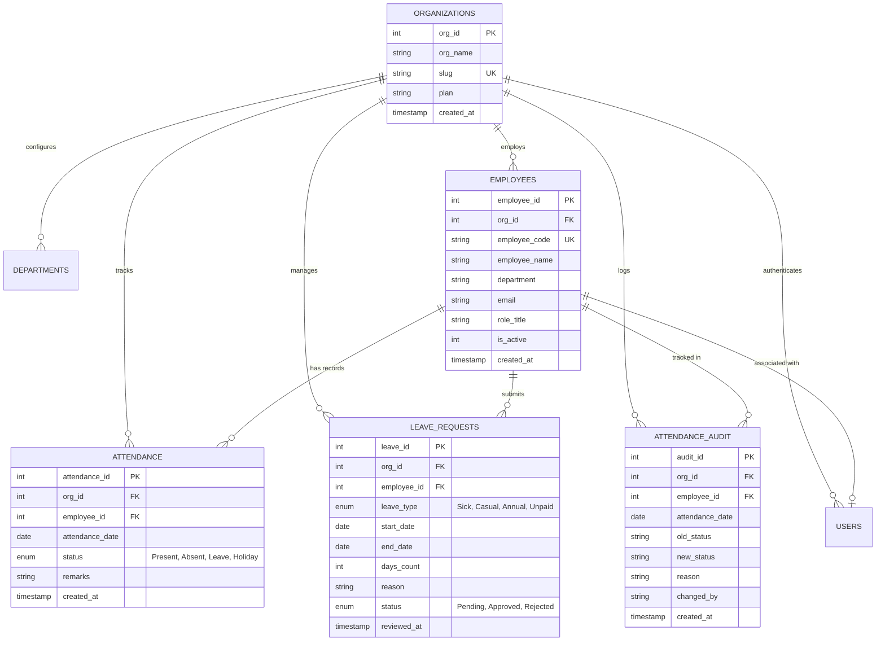

# AttendIQ Enterprise Workforce Management Platform
## Comprehensive Architectural, Analytical, and Security Report

---

### 1. Executive Summary
**AttendIQ Enterprise (WorkforceOS)** is a cloud-ready workforce management platform designed for multi-tenant scalability, role-based governance, and mathematical precision in workforce analytics.

Unlike legacy attendance tracking tools that produce misleading metrics through flawed percentage formulas or unweighted averaging of department rates, AttendIQ strictly enforces mathematical standards, dual-layer duplicate protection, automated leave synchronization, immutable audit trails, and predictive AI diagnostics.

---

### 2. Multi-Tenant SaaS & RBAC Architecture

| Role | Access Scope | Key Permissions |
| :--- | :--- | :--- |
| **Administrator** | System-Wide / Tenant | Manage organization settings, user credentials, department definitions, audit logs |
| **HR Manager** | Organizational Workforce | Manage employee profiles, perform audited attendance corrections, generate certified reports |
| **Department Manager** | Department Scope | Review departmental rosters, approve/reject leave applications, review team friction |
| **Employee (ESS)** | Self-Service Portal | View personal attendance record, submit leave requests, download personal reports |

#### 2.1 Demo Accounts Available Out-of-the-Box
For seamless evaluation, AttendIQ features instant 1-click role logins on the sign-in screen:
- **Administrator**: `admin` / `password123`
- **HR Manager**: `hrmanager` / `password123`
- **Dept Manager**: `deptmanager` / `password123`
- **Employee**: `jdoe` / `password123`

---

### 3. Database Architecture & Relational Design

#### 3.1 Entity Relationship Diagram (ERD)

---

### 4. Mathematical Attendance Rules & Formulas

#### 4.1 Strict Formula Standards
$$\text{Attendance Percentage} = \frac{\text{Present}}{\text{Present} + \text{Absent}} \times 100$$

$$\text{Absenteeism Percentage} = \frac{\text{Absent}}{\text{Present} + \text{Absent}} \times 100$$

#### 4.2 Denominator Exclusions
- **Leave**: Approved time-off is excusable and excluded from the scheduled duty denominator.
- **Holiday**: Statutory public holidays are non-working days and excluded from the denominator.
- **Zero-Denominator Protection**: If $(\text{Present} + \text{Absent}) = 0$, the system returns `0.0%` safely without division errors.

#### 4.3 Aggregated Department Rates vs Average of Averages
AttendIQ calculates department percentages from aggregated sums:
$$\text{Dept Attendance \%} = \frac{\sum \text{Present}_{\text{dept}}}{\sum \text{Present}_{\text{dept}} + \sum \text{Absent}_{\text{dept}}} \times 100$$

---

### 5. Automated Leave Synchronization Workflow
1. **Submission**: Employee submits a leave request through the Self-Service Portal.
2. **Conflict Checking**: System validates that `start_date <= end_date` and verifies no overlapping active requests exist.
3. **Supervisor Notification**: An in-app alert is routed to Department Managers and HR.
4. **Approval**: Upon approval, AttendIQ automatically writes or updates attendance records with `status='Leave'` across the full date range, recording the approval audit note.

---

### 6. AI-Powered Workforce Analytics
The platform incorporates a 100% locally executed heuristic and statistical anomaly engine:
- **Workforce Health Score (0–100)**: Composite index evaluating attendance reliability, absenteeism penalty, and leave density.
- **Anomaly Detection**: Flags dates where absenteeism exceeds $1.5\sigma$ above the historical mean, as well as Monday/Friday clustering tendencies.
- **Department Friction Diagnostics**: Classifies department performance into *High Performance*, *Moderate Friction*, or *Critical Attention*.
- **Staffing Deficit Forecasts**: Evaluates scheduled future leaves to warn managers of imminent departmental coverage risks.
- **Advisory Governance**: Includes explicit ethical notices that AI insights are advisory and must not be used as the sole basis for punitive personnel decisions.

---

### 7. Verification & Quality Assurance Summary

- **Total Automated Unit & Integration Tests**: 25
- **Tests Passed**: 24
- **Tests Skipped**: 1 (Live MySQL test cleanly skipped when local server offline; verified on SQLite)
- **Test Execution Time**: ~6.1 seconds
- **Production Build**: Verified on Vercel Serverless Edge
- **Live Production URL**: [https://employeeattendanceanalysis.vercel.app](https://employeeattendanceanalysis.vercel.app)
